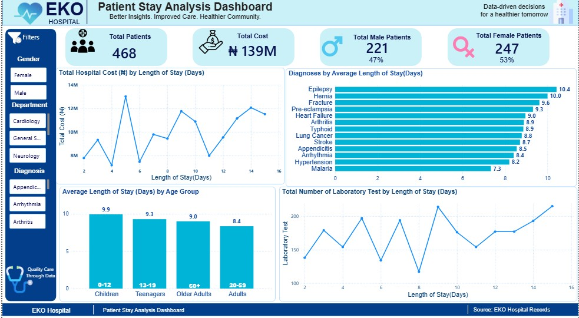

# 🏥 EKO Hospital – Patient Stay Analysis Dashboard

A Power BI dashboard analysing patient length of stay, hospital cost and laboratory workload at EKO Hospital. Built as a capstone project for the Tech4Africans / TechCrush program.

## 📊 Key Metrics

- **Total Patients:** 468 (221 male, 247 female)
- **Total Cost:** ₦139M

## 🔍 Key Insights

- Epilepsy (10.4 days), Hernia (10.0) and Fracture (9.6) have the longest average stays; Malaria is shortest (7.3).
- Children (0–12) stay longest on average (9.9 days); Adults (20–59) stay shortest (8.4).
- Cost and lab tests generally rise with length of stay.

## 🧩 Features

- KPI cards, cost and lab-test trend charts, diagnosis and age-group analysis
- Filters for gender, department and diagnosis

## 🛠️ Tools

Microsoft Excel and Power BI

## 👩🏽‍💻 My Role

Designed and built the dashboard for the team.

## 📬 Contact

Olawumi matthew boluwatife – Olawumimatthew135@gmail.com
